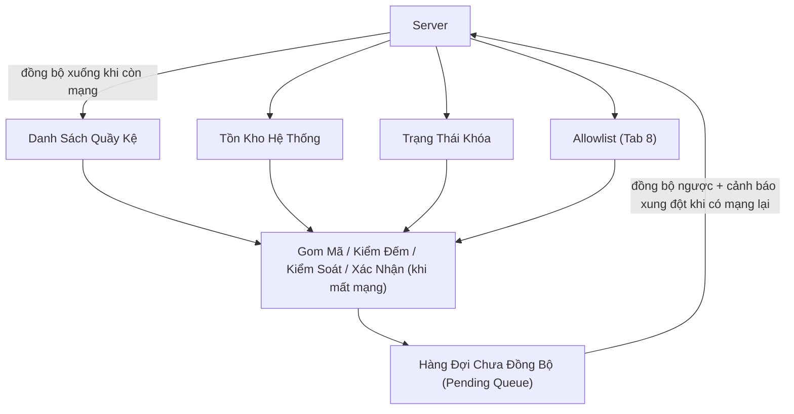

# Online/Offline cho Kiểm Kê + mở rộng offline cho Kiểm Soát Hàng Hóa

**Trạng thái: Đã xác nhận hướng, đang triển khai** (12/2026).

Bản xem có sơ đồ minh hoạ (kiến trúc đồng bộ 2 chiều) — bản đề xuất gốc:
https://claude.ai/artifact/XSSt4p6exGY6tG3QXhGmXw

## Tóm tắt & mục tiêu

Yêu cầu người dùng: Kiểm Kê làm việc được khi mất mạng — Gom Mã, Kiểm Đếm,
Kiểm Soát và cả Xác Nhận vẫn thao tác được offline; đồng bộ sẵn **tồn kho**
và **danh sách quầy kệ** xuống máy để vẫn chọn được quầy kệ khi không có
mạng; xử lý đúng đắn tính năng **Khóa Quầy Kệ** (mới thêm 12/2026) khi
offline — không để khóa trở thành vô nghĩa, nhưng cũng không chặn người
dùng vô lý. Đồng thời mở rộng offline cho Kiểm Soát Hàng Hóa: **Đối Chiếu**,
**Hạn Sử Dụng**, **Báo Cáo**.

Mục tiêu chịu được: mất mạng vài giờ, hoặc đứng ở vị trí sóng yếu trong
kho, nhân viên vẫn tiếp tục làm việc bình thường, dữ liệu tự đồng bộ lại
khi có mạng.

## Hiện trạng trước khi làm (tham khảo)

| Chức năng | Hiện trạng offline (trước đợt này) |
| --- | --- |
| Ghi Nhận (Kiểm Soát HH) | ✅ Offline đầy đủ — hàng đợi `pendingRecords` trong IndexedDB `hcrcShelfOfflineDb`, tự đồng bộ khi có mạng lại |
| Kiểm Tra Giá (Kiểm Soát HH) | ✅ Cache-first — đọc cache `priceCatalog` trước, chỉ gọi API ngoài khi cache miss |
| Hạn Sử Dụng (Kiểm Soát HH) | ⚠️ Có dự phòng nhưng "live-first" |
| Đối Chiếu (Kiểm Soát HH) | ⚠️ Có dự phòng nhưng "live-first" |
| Báo Cáo (Kiểm Soát HH) | ❌ Không có dự phòng — cache RAM, mất khi tải lại trang |
| Gom Mã / Kiểm Đếm / Kiểm Soát (Kiểm Kê) | ❌ Không offline — `fetch()` thuần, mất mạng = mất lượt quét |
| Xác Nhận / Gỡ Xác Nhận (Kiểm Kê) | ❌ Không offline |
| Chọn Quầy Kệ để quét (Kiểm Kê) | ❌ Phụ thuộc mạng — tải API mỗi lần vào tab |

Dữ liệu tồn kho hệ thống vốn chỉ được server đồng bộ ngầm **~20 phút/lần**
(`jobs/inventorySync.js`, cấu hình được qua `inventoryApiConfig.syncIntervalMinutes`,
tick kiểm tra mỗi 5 phút ở `server.js`) — nghĩa là gọi "live" từ client
cũng chỉ trả về đúng snapshot đó, không tức thời hơn. Giá chỉ refresh đầy
đủ 1 lần/ngày (`jobs/priceSync.js`). Đây là cơ sở để chuyển Đối
Chiếu/Hạn Sử Dụng sang cache-first mà không giảm độ chính xác.

## Kiến trúc Kiểm Kê offline

Mở rộng đúng cơ chế offline đã chứng minh hiệu quả ở Ghi Nhận (IndexedDB
`hcrcShelfOfflineDb`), không viết cơ chế mới từ đầu:

1. **Tải cache xuống** (khi còn mạng, mỗi lần vào tab Kiểm Kê, giống
   `syncShelfPriceCatalogSilently()`): danh sách quầy kệ + `kiemKeLocked`,
   allowlist Tab 8 của user, kỳ kiểm kê đang hoạt động, tồn kho hệ thống.
2. **Mất mạng, vẫn thao tác**: lượt quét (Gom Mã/Kiểm Đếm/Kiểm Soát) ghi
   vào hàng đợi mới `kkPendingScans` trong cùng DB, UI cập nhật ngay
   (optimistic), gắn nhãn "⏳ Chưa đồng bộ". Xác Nhận/Gỡ Xác Nhận cũng vào
   hàng đợi tương tự nhưng kèm cảnh báo rõ "có thể bị từ chối nếu trạng
   thái đã đổi" (rủi ro xung đột cao hơn quét đơn thuần). Chọn quầy kệ đọc
   từ cache đã tải, có nhãn "(ngoại tuyến — dữ liệu lúc hh:mm)".
3. **Có mạng lại, đồng bộ ngược**: vòng lặp kiểu
   `trySyncPendingShelfRecords()` gửi từng item lên đúng route thật, báo
   kết quả rõ ràng (thành công/bị từ chối + lý do), không âm thầm bỏ qua.

## Khóa Quầy Kệ khi offline — không vô hiệu hoàn toàn

Nếu bỏ hẳn kiểm tra khóa khi offline, tính năng Khóa trở thành "dễ lách"
(chỉ cần tắt mạng là vượt được khóa IT vừa đặt) — đi ngược đúng mục đích
ban đầu của tính năng này. **Quyết định: giữ kiểm tra khóa theo trạng thái
đồng bộ gần nhất** (dữ liệu khóa là 1 trong 4 thứ được cache ở bước 1 nên
luôn có sẵn để kiểm tra kể cả khi mất mạng):

- Quầy đang Khóa lúc tải cache → chặn đúng như online.
- Quầy đang Mở lúc tải cache, IT khóa trong lúc nhân viên đang offline
  thao tác tiếp → hợp lý vì không ai biết trước; khi đồng bộ lại, hệ thống
  chỉ **cảnh báo cho IT** "có dữ liệu nộp lên từ lúc quầy đang bị khóa" để
  họ tự xem xét, không tự động từ chối hay tự động chấp nhận.

## Đối Chiếu & Hạn Sử Dụng — chuyển sang cache-first

Áp dụng đúng mô hình "cache-first" mà Kiểm Tra Giá đang dùng ổn định (thay
vì "live-first, rơi về cache chỉ khi lỗi" như hiện tại): đọc cache
(`recon`/`systemInventory`) trước, hiển thị ngay cả khi offline; nếu có
mạng thì âm thầm làm mới cache ngầm phía sau; thêm nhãn "Dữ liệu lúc
hh:mm" để minh bạch độ mới. Hạn Sử Dụng ưu tiên thấp hơn Đối Chiếu vì cơ
chế hiện tại đã hoạt động được khi offline (chỉ chậm hơn).

## Báo Cáo — thêm cache offline mới

Hiện dùng cache chỉ lưu RAM (`shelfReportSystemInventoryCache`), mất khi
tải lại trang, không có IndexedDB. Thêm 1 key cache riêng trong
`hcrcShelfOfflineDb` + cùng cơ chế cache-first. Ưu tiên thấp nhất vì Báo
Cáo thường được xem lúc có mạng (văn phòng/tổng hợp cuối ca).

## Thứ tự triển khai

1. Kiểm Kê: Gom Mã / Kiểm Đếm / Kiểm Soát offline + cache quầy kệ/tồn
   kho/khóa/allowlist (khoảng trống lớn nhất).
2. Kiểm Kê: Xác Nhận / Gỡ Xác Nhận offline (dùng chung hạ tầng hàng đợi,
   test kỹ hơn vì rủi ro xung đột cao hơn).
3. Đối Chiếu → cache-first.
4. Hạn Sử Dụng → cache-first.
5. Báo Cáo → thêm cache offline.

Toàn bộ không đổi route/quyền hiện có — chỉ thêm lớp cache/hàng đợi phía
client; 4 lớp kiểm tra quyền hiện có ở server (kể cả Khóa Quầy Kệ) vẫn áp
dụng y nguyên khi đồng bộ ngược.
