# Quy Trình Module "📋 Kiểm Kê" (as-built)

**Trạng thái: Tài liệu tham khảo, mô tả đúng hệ thống đã triển khai thật
(11-12/2026)** — khác với [kiem-ke-sieu-thi.md](./kiem-ke-sieu-thi.md) (bản
đề xuất/phân tích GỐC, viết trước khi code, giữ lại làm lịch sử quyết định).
Hướng dẫn cấu hình/sử dụng chi tiết từng trường dữ liệu vẫn ở
`../deploy/Huong-dan-nghiep-vu.md` (mục "📋 Kiểm Kê") — tài liệu này tập
trung vào **luồng thao tác thực tế** kèm ảnh chụp màn hình thật.

## Tổng Quan

Quy trình Kiểm Kê đi qua **6 bước tuần tự** trong module "📋 Kiểm Kê"
(sidebar chính), từ lúc mở một Kỳ cho tới khi ra Báo Cáo so sánh cuối cùng.
Mỗi bước ứng với 1 sub-tab trong màn Kiểm Kê, và bước sau chỉ thao tác được
khi bước trước đã có dữ liệu/kỳ đang hoạt động.

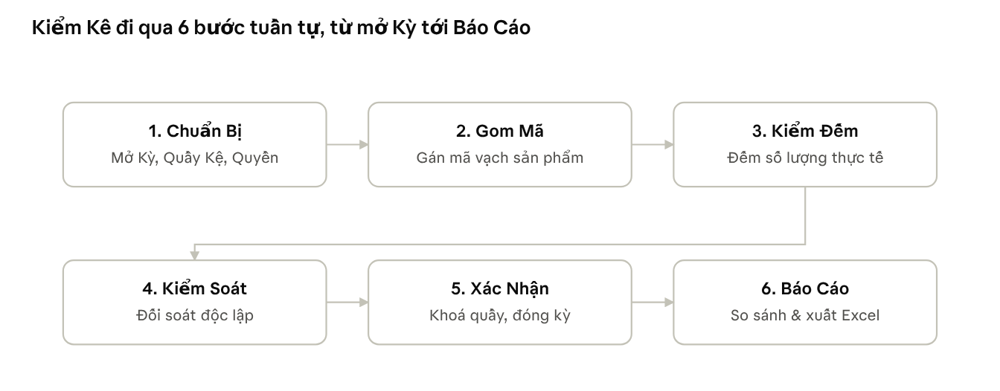

Ghi chú: "Kiểm Soát" là bước đối soát ĐỘC LẬP với "Kiểm Đếm" — vẫn thao tác
được bình thường dù quầy kệ đó đã được Xác Nhận ở bước Kiểm Đếm (chỉ Kiểm
Đếm bị khoá ngay khi Xác Nhận, Kiểm Soát thì không), để đảm bảo người kiểm
soát luôn đối chiếu được độc lập.

## Bước 1 — Chuẩn Bị

Trước khi thao tác, quản lý siêu thị (hoặc admin) phải chuẩn bị 3 thứ: **mở
Kỳ**, **khai báo Quầy Kệ**, và **gán quyền thao tác theo từng quầy kệ** cho
từng nhân viên.

### Mở Kỳ Kiểm Kê (tab "📅 Kỳ Kiểm Kê")

Có 2 loại Kỳ: **Gom Mã** (dùng cho bước 2) và **Kiểm Kê** (dùng cho cả Kiểm
Đếm + Kiểm Soát). Mỗi siêu thị có thể có đồng thời 1 Kỳ Gom Mã **và** 1 Kỳ
Kiểm Kê đang "🟢 Đang hoạt động" song song, không xung đột nhau — nhưng
không được mở 2 Kỳ cùng loại cùng lúc. Bấm **"Đóng Kỳ"** để kết thúc một Kỳ.

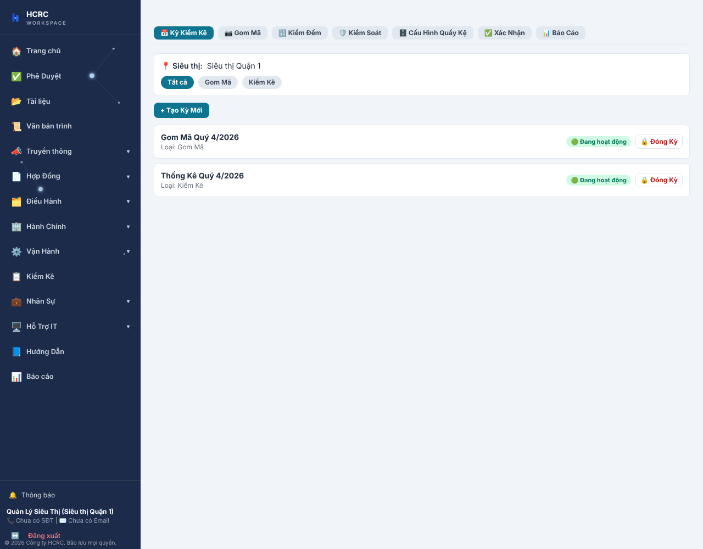

### Khai Báo Quầy Kệ (tab "🗄️ Cấu Hình Quầy Kệ")

Danh mục Quầy Kệ dùng **CHUNG** với module "📦 Kiểm Soát Hàng Hóa" — xem
đúng/đủ ngay ở đây (mã, tên, ngành hàng), muốn thêm/sửa/xoá/nhập Excel hàng
loạt thì sang màn quản lý đầy đủ qua nút "Mở Quản Lý Quầy Kệ".

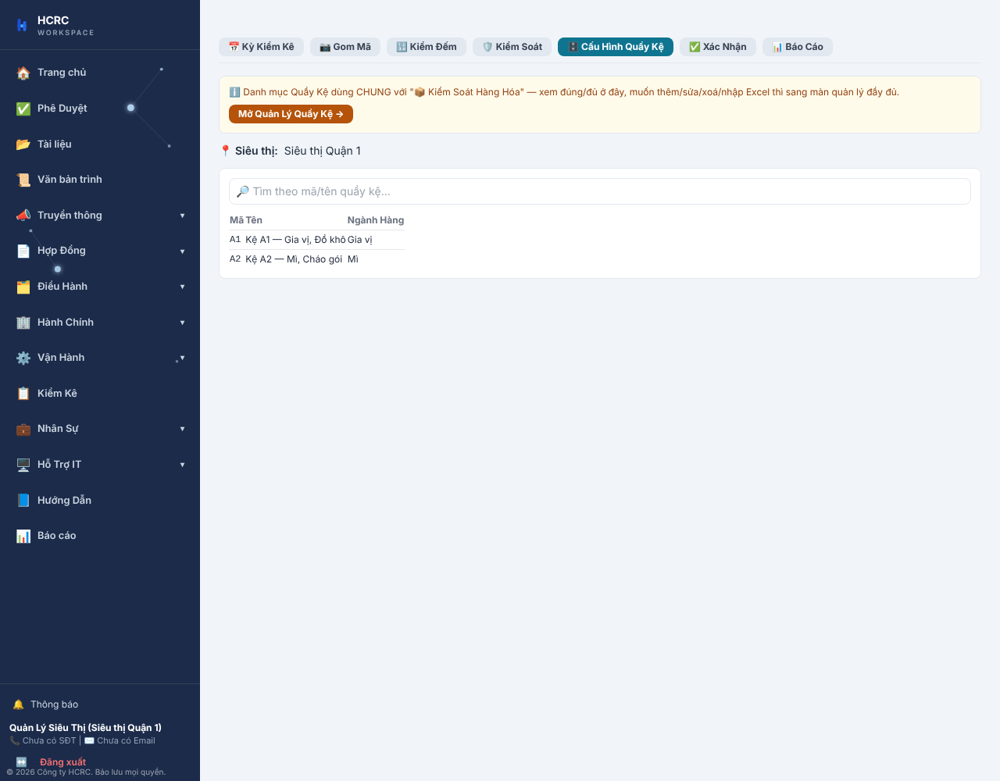

### Gán Quyền Thao Tác (tab "🔑 Cấu Hình Người Dùng")

Đây là **danh sách trắng tuyệt đối** (allowlist): dù là admin cũng phải
được gán rõ mới quét được ở 1 quầy kệ cụ thể (admin chỉ bypass kiểm tra
quyền Kiểm Kê nói chung, không bypass allowlist theo quầy). Mỗi dòng gán
riêng 3 quyền nhỏ: **Gom Mã / Kiểm Đếm / Kiểm Soát** — có thể cho 1 người
chỉ được Gom Mã mà không được Kiểm Đếm, hoặc ngược lại. Chỉ Admin/người
được cấp riêng quyền này mới thấy tab này.

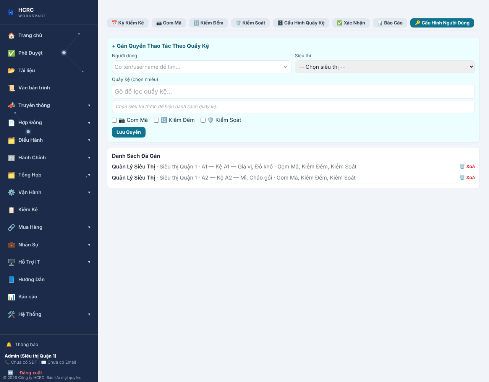

## Bước 2 — Gom Mã (tab "📷 Gom Mã")

Dùng khi hàng chưa có mã trong hệ thống — quét/gõ mã để **gom số lượng
theo mã hàng** trước khi vào đợt Kiểm Kê chính thức, không ảnh hưởng tồn
kho hệ thống. Cần 1 Kỳ loại "Gom Mã" đang hoạt động và được gán quyền Gom
Mã ở đúng quầy kệ đang chọn (Bước 1).

Ô quét nhận diện đúng sản phẩm dù gõ/quét **1 trong 3 loại mã** mà API đối
tác trả về: mã nội bộ, mã vạch nhà sản xuất mặc định, hoặc 1 mã vạch phụ
(khi 1 mã hàng có nhiều mã vạch do đóng gói khác quy cách) — thử theo thứ
tự Mã Vạch → Mã Nội Bộ → 6 số cuối (chỉ nhận khi khớp DUY NHẤT 1 sản phẩm).

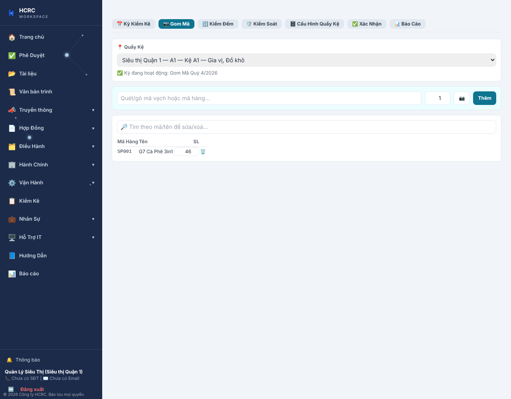

## Bước 3 — Kiểm Đếm (tab "🔢 Kiểm Đếm")

Nhân viên đếm **số lượng thực tế** theo từng quầy kệ, cần 1 Kỳ loại "Kiểm
Kê" đang hoạt động.

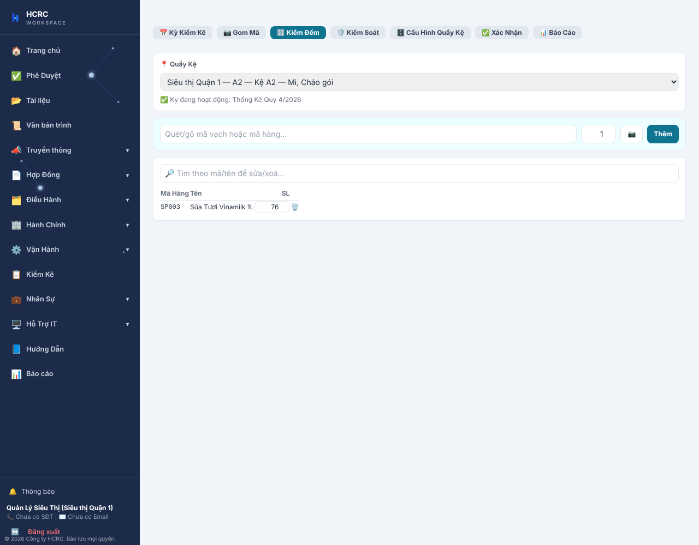

**Quầy kệ đã được Xác Nhận ở Bước 5 thì bị KHOÁ NGAY** tại đây — chọn lại
quầy đó là thấy khoá liền, không đợi đến khi bấm quét/lưu mới báo. Muốn đếm
lại phải quay lại tab "✅ Xác Nhận" bấm **"Gỡ Xác Nhận"** trước.

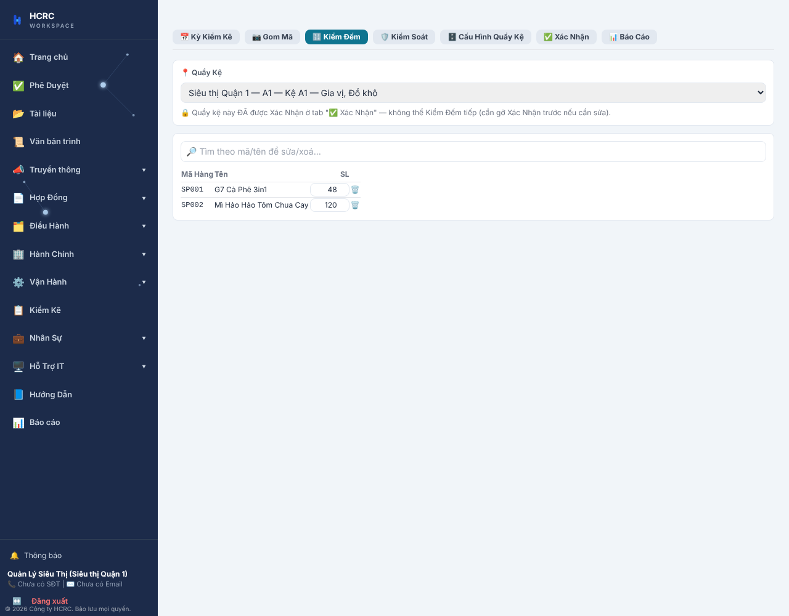

## Bước 4 — Kiểm Soát (tab "🛡️ Kiểm Soát")

Đối soát **độc lập** lại số liệu Kiểm Đếm (cột "SL Kiểm Đếm" chỉ để đối
chiếu, cột "SL Soát" mới là số người kiểm soát nhập).

**Khác với Kiểm Đếm ở Bước 3: tab này KHÔNG BAO GIỜ bị khoá bởi trạng thái
Xác Nhận** — quầy kệ dù đã Xác Nhận hay chưa Xác Nhận đều thao tác Kiểm
Soát được bình thường. Đây là thiết kế cố ý: Xác Nhận chỉ chốt số đếm của
Kiểm Đếm, không ngăn người kiểm soát đối chiếu độc lập sau đó.

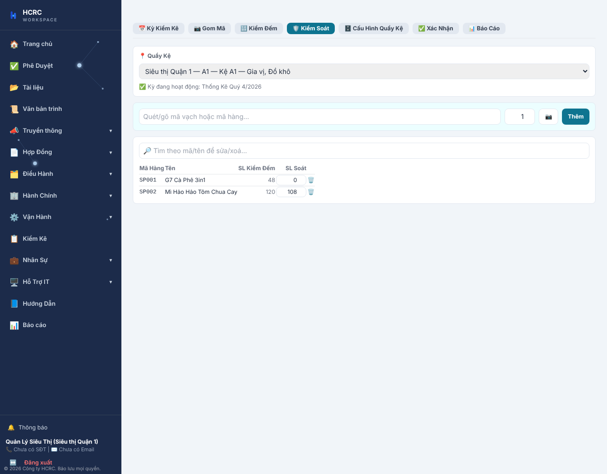

## Bước 5 — Xác Nhận & Đóng Kỳ (tab "✅ Xác Nhận")

Chỉ hiện quầy kệ đã có hoạt động Kiểm Đếm trong Kỳ đang chọn. Bấm **"Xác
Nhận"** từng quầy khi đã đếm xong — ngay lập tức quầy đó bị khoá Kiểm Đếm
(Bước 3), muốn đếm lại thì bấm **"Gỡ Xác Nhận"** ngay tại đây.

Nút **"Xác Nhận Toàn Bộ Đợt Kiểm Kê (Đóng Kỳ)"** chỉ mở khoá khi **TẤT CẢ**
quầy kệ đã có Kiểm Đếm đều đã được Xác Nhận — ảnh dưới đây quầy A1 đã Xác
Nhận nhưng A2 chưa, nên nút đóng đợt vẫn xám, kèm dòng nhắc "Còn quầy kệ đã
Kiểm Đếm nhưng chưa Xác Nhận — chưa thể đóng kỳ".

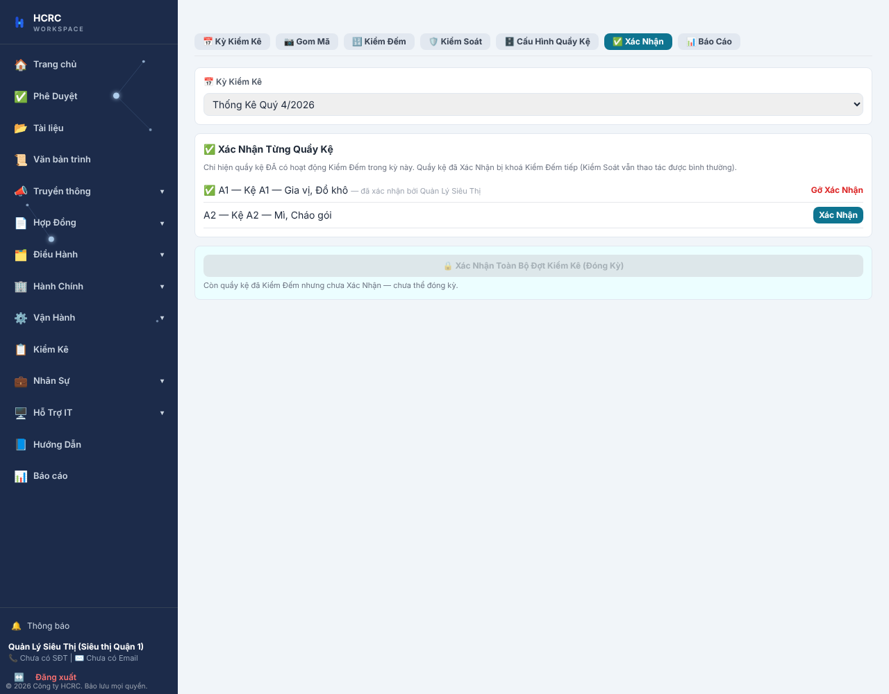

## Bước 6 — Báo Cáo (tab "📊 Báo Cáo")

Chọn 1 Kỳ ở đầu màn để xem 4 thẻ số liệu tổng (tổng mã, mã đã đếm, tổng SL
cuối cùng, chênh lệch so hệ thống), biểu đồ so sánh **Tồn Kho Hệ Thống vs
Kiểm Đếm vs Kiểm Soát**, vòng tròn tiến độ, và bảng chi tiết theo mã hàng
(có phân trang, xuất Excel nhiều sheet).

Một Kỳ Kiểm Kê **chỉ so với đúng Tồn Kho Hệ Thống/Kiểm Đếm/Kiểm Soát của
chính nó** — không tự trộn Gom Mã của 1 Kỳ khác vào.

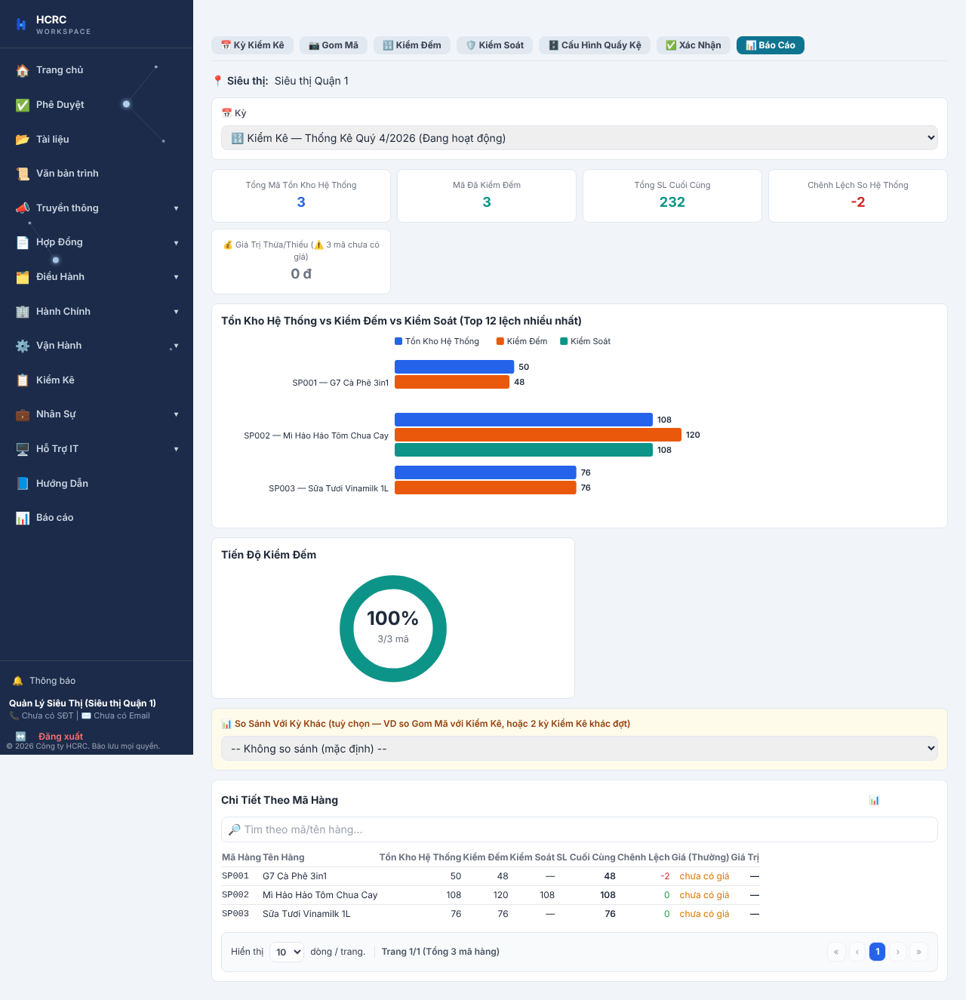

Muốn so sánh với 1 Kỳ khác (VD so Gom Mã với Kiểm Kê, hay 2 Kỳ Kiểm Kê khác
đợt) thì dùng riêng khung **"So Sánh Với Kỳ Khác"** — chọn tùy ý, không bắt
buộc. Admin còn thấy thêm mục so sánh **giữa các siêu thị** (Phase 1 chỉ
dành riêng cho Admin).

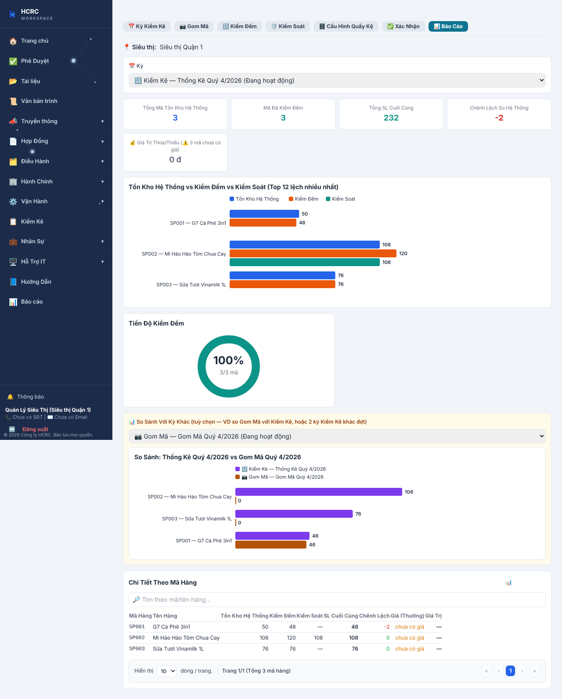

## Phân Quyền Theo Vai Trò

8 quyền riêng trong khối "27. Kiểm Kê" của Ma Trận Phân Quyền, mỗi quyền
ứng đúng 1 trong 8 tab đã nêu ở trên:

| Quyền | Dùng cho tab | Ghi chú |
| --- | --- | --- |
| Quản Lý Kỳ Kiểm Kê | 📅 Kỳ Kiểm Kê | Mở Kỳ mới, đóng Kỳ thủ công |
| Gom Mã | 📷 Gom Mã | Cần thêm allowlist đúng quầy kệ ở Bước 1 |
| Kiểm Đếm | 🔢 Kiểm Đếm | Cần thêm allowlist đúng quầy kệ ở Bước 1 |
| Kiểm Soát | 🛡️ Kiểm Soát | Cần thêm allowlist đúng quầy kệ ở Bước 1 |
| Quản Lý Cấu Hình Quầy Kệ | 🗄️ Cấu Hình Quầy Kệ | Danh mục quầy kệ dùng chung với Kiểm Soát Hàng Hóa |
| Xác Nhận | ✅ Xác Nhận | Xác Nhận/Gỡ Xác Nhận từng quầy, đóng đợt |
| Xem Báo Cáo | 📊 Báo Cáo | So sánh giữa các siêu thị chỉ Admin mới thấy |
| Quản Lý Người Dùng (allowlist) | 🔑 Cấu Hình Người Dùng | Chỉ Admin/người được cấp riêng mới thấy tab này |

Lưu ý quan trọng: **có quyền Gom Mã/Kiểm Đếm/Kiểm Soát thôi là CHƯA đủ** —
phải có thêm dòng allowlist ở tab "🔑 Cấu Hình Người Dùng" chỉ đích danh
quầy kệ đó thì mới quét được, kể cả tài khoản Admin.
